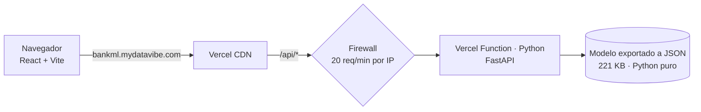

# 🏦 Bank Propensity Scorer

> *Priorizá las llamadas con más chances de cerrar un depósito a plazo.*

Modelo de Machine Learning (LightGBM) que estima la **probabilidad calibrada** de que un cliente contrate un **depósito a plazo fijo** a partir de los datos de una llamada de marketing, la traduce a una **prioridad de llamada** (alta / media / baja) y explica qué factores la empujaron.

🌐 **Demo:** https://bankml.mydatavibe.com  
🎓 Proyecto académico — FIUBA, Ingeniería en IoT y Machine Learning  
🛠️ Hecho en [mydatavibe.com](https://mydatavibe.com)

## 🧠 Qué hace

El operador responde unas pocas preguntas en español (o carga un perfil de ejemplo) y la app devuelve:

- **Probabilidad calibrada** de contratación (coincide con la tasa real observada) y cuántas veces más probable es que el cliente promedio.
- **Prioridad de llamada:** alta (≥ 30 %), media (12–30 %) o baja (< 12 %).
- **Factores principales** en lenguaje claro (TreeSHAP exacto, agrupado), con detalle técnico opcional.
- **Sección del modelo** con AUC, curva de ganancia, calibración y desempeño por prioridad, medidos en datos que el modelo no vio.
- **Hallazgo:** el *cuándo* se llama pesa más que el *a quién* (la tasa real pasó de 3–6 % en 2008 a 40–60 % en 2009–2010).

El formulario es una capa amigable: la app traduce las respuestas a las 19 variables del dataset (por ejemplo, el período elegido completa solo el contexto económico).

## 🏗️ Arquitectura



| Capa | Tecnología |
|---|---|
| Frontend | React 19 + Vite (estático, servido por Vercel CDN) |
| API | FastAPI en Vercel Functions (Python) — **una invocación por consulta** |
| Modelo | Entrenado con LightGBM; en producción se sirve desde `models/model.json` con un motor en **Python puro** (sin LightGBM/numpy/pandas) |
| Anti-abuso | Regla de firewall de Vercel (20 req/min por IP) + límite por IP en la función. **Sin base de datos**: la demo no guarda nada |
| DNS | Subdominio `bankml` → Vercel (CNAME en Hostinger) |

### Free tier y protección contra abuso
La demo corre íntegra en planes gratuitos, por lo que la API limita el uso: validación estricta de entrada (enums y rangos del dataset), tope de 4 KB por request, regla de **firewall de Vercel (20 req/min por IP)** y, en la función, **6 consultas/min y 40/día por IP** (contadores en memoria). No hay base de datos ni se guardan las respuestas. Si alguien agotara la cuota, el plan Hobby pausa el proyecto en lugar de cobrar.

Más detalle, decisiones y trade-offs en [`docs/architecture.md`](docs/architecture.md).

## 📜 Historia del proyecto: de AWS a Vercel

**v1 (2025) — AWS.** Frontend estático en **S3** y backend Flask en **EC2** con Docker. El modelo se empaquetó en un contenedor que implementa el contrato de inferencia de **SageMaker** (`/ping`, `/invocations`) para poder migrar luego a un endpoint administrado.

> ⚠️ **Aclaración honesta:** **no se utilizó SageMaker administrado** (ni Training, ni Endpoints). El contenedor "SageMaker-compatible" corría simulado sobre EC2. Por eso el README original hablaba de "reemplazar el servicio Docker simulado por un endpoint real".

Esa infraestructura se dio de baja. El código original se conserva en [`legacy/aws/`](legacy/aws/) como referencia.

**v2 (actual) — Vercel.** Misma idea, sin servidores que mantener, sin costos fijos y con despliegue continuo desde GitHub.

### Correcciones al migrar
Durante la migración se encontraron y corrigieron tres errores de la v1, y se agregó calibración de probabilidades:

1. **Resultado invertido en la UI:** `y = 1` significa *"sí contrata"* (ver `ml/train.py`), pero la interfaz y el README lo mostraban al revés.
2. **Variable faltante (`nr.employed`):** el modelo la usa como feature, pero el formulario nunca la enviaba y el preprocesador la rellenaba con `0`. Medido sobre una muestra del dataset: AUC **0.70** (sin la variable, como en la v1) vs **0.83** (con ella), y 68 % de positivos predichos vs 19 % real. La v2 la pide en el formulario.
3. **Inferencia fila-por-fila distinta al entrenamiento:** `pd.get_dummies(..., drop_first=True)` sobre un único registro descartaba siempre la columna del mes, así que `month` no influía nunca en producción. En una muestra, el **26 %** de las predicciones difería de la inferencia en lote. La v2 reimplementa el preprocesamiento con la semántica de entrenamiento y un test de paridad lo verifica.

## 🧪 Modelo

- **Datos:** [Bank Marketing](https://archive.ics.uci.edu/dataset/222/bank+marketing) (`data/raw/`), ~11 % de clase positiva.
- **Preprocesamiento** (`ml/preprocessing.py`): binning de edad, winsorización de `campaign`, índice económico por PCA, agrupación de `job`/`month`, codificaciones ordinales y one-hot. Se elimina `duration` por *data leakage*.
- **Modelo:** LightGBM con `scale_pos_weight`, GridSearch optimizando *recall*.
- **Calibración:** `scale_pos_weight` infla las probabilidades (un 0,86 del modelo equivale a ~53 % real). Se calibró con Platt sobre el set de test: el error Brier baja de 0,149 a 0,074.
- **Resultados en test (8.238 llamadas):** AUC 0,82; la prioridad alta (13 % de las llamadas) acierta el 49 % y cubre el 56 % de las contrataciones. La prioridad baja aún contiene el 34 %, por eso es una herramienta para **priorizar**, no para descartar.
- **Exploración y comparación de modelos:** [`presentacion.md`](presentacion.md).

## 🚀 Correr en local

```bash
# API
python3 -m venv .venv && source .venv/bin/activate
pip install -r requirements.txt uvicorn
PYTHONPATH=api uvicorn index:app --port 8000

# Frontend (en otra terminal; proxea /api a localhost:8000)
cd frontend && npm ci && npm run dev

# Tests (incluye paridad contra LightGBM/scikit-learn)
pip install -r requirements-train.txt && pytest tests -q
```

Reentrenar y re-exportar (desde la raíz): `python ml/train.py && python ml/export_model.py` (genera `models/model.json` con la calibración y `frontend/src/data/insights.json` con las métricas de la UI).

### Variables de entorno (opcionales)

| Variable | Default | Uso |
|---|---|---|
| `LIMIT_PER_MIN` | 6 | Consultas por minuto por IP |
| `LIMIT_PER_DAY_IP` | 40 | Consultas por día por IP |

## 📂 Estructura

```
api/            API FastAPI (Vercel Function) + límites anti-abuso
frontend/       React + Vite (UI en español, gráficos SVG propios)
ml/             Preprocesamiento, entrenamiento y exportación a JSON
models/         Pipeline entrenado (.joblib) y modelo portable (model.json)
data/           Dataset y ejemplos
notebooks/      Exploración (EDA)
docs/           Arquitectura y decisiones
legacy/aws/     v1: contenedor SageMaker-compatible, backend Flask, docker-compose
tests/          Tests de la API
```

## 👨‍💻 Autor
Rodrigo Pinedo · 📩 rodrigo.j.pinedo@gmail.com  
🔗 [LinkedIn](https://www.linkedin.com/in/rodrigopinedo/) | [GitHub](https://github.com/rodri-iot)
