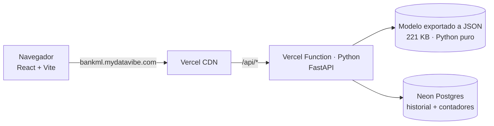

# 🏦 Predicción Inteligente Bancaria

Modelo de Machine Learning (LightGBM) que estima si un cliente contratará un **depósito a plazo fijo** a partir de los datos de una llamada de marketing, con explicación de qué variables empujaron la decisión.

🌐 **Demo:** https://bankml.mydatavibe.com  
🎓 Proyecto académico — FIUBA, Ingeniería en IoT y Machine Learning

## 🧠 Qué hace

El operador completa los datos del cliente (o carga uno de los casos precargados) y la app devuelve:

- **Predicción:** `1` = el cliente **SÍ** contratará el depósito, `0` = **NO**.
- **Probabilidad** de contratación.
- **Contribución de cada variable** (log-odds, equivalente a valores SHAP en modelos de árboles) para entender el porqué.
- **Historial** de las últimas predicciones.

## 🏗️ Arquitectura



| Capa | Tecnología |
|---|---|
| Frontend | React 19 + Vite (estático, servido por Vercel CDN) |
| API | FastAPI en Vercel Functions (Python 3.12) — **una invocación por consulta** |
| Modelo | Entrenado con LightGBM; en producción se sirve desde `models/model.json` con un motor en **Python puro** (sin LightGBM/numpy/pandas) |
| Historial / límites | Neon Postgres (free tier); sin base, degrada a memoria |
| DNS | Subdominio `bankml` → Vercel (CNAME en Hostinger) |

### Free tier y protección contra abuso
La demo corre íntegra en planes gratuitos, por lo que la API limita el uso: validación estricta de entrada (enums y rangos del dataset), tope de 4 KB por request, **6 consultas/min y 40/día por IP** (hasheada), **1500/día globales** y purga de datos a los 2 días. Los límites son configurables por variables de entorno (ver más abajo).

Más detalle, decisiones y trade-offs en [`docs/architecture.md`](docs/architecture.md).

## 📜 Historia del proyecto: de AWS a Vercel

**v1 (2025) — AWS.** Frontend estático en **S3** y backend Flask en **EC2** con Docker. El modelo se empaquetó en un contenedor que implementa el contrato de inferencia de **SageMaker** (`/ping`, `/invocations`) para poder migrar luego a un endpoint administrado.

> ⚠️ **Aclaración honesta:** **no se utilizó SageMaker administrado** (ni Training, ni Endpoints). El contenedor "SageMaker-compatible" corría simulado sobre EC2. Por eso el README original hablaba de "reemplazar el servicio Docker simulado por un endpoint real".

Esa infraestructura se dio de baja. El código original se conserva en [`legacy/aws/`](legacy/aws/) como referencia.

**v2 (actual) — Vercel.** Misma idea, sin servidores que mantener, sin costos fijos y con despliegue continuo desde GitHub.

### Correcciones al migrar
Durante la migración se encontraron y corrigieron tres errores de la v1:

1. **Resultado invertido en la UI:** `y = 1` significa *"sí contrata"* (ver `ml/train.py`), pero la interfaz y el README lo mostraban al revés.
2. **Variable faltante (`nr.employed`):** el modelo la usa como feature, pero el formulario nunca la enviaba y el preprocesador la rellenaba con `0`. Medido sobre una muestra del dataset: AUC **0.70** (sin la variable, como en la v1) vs **0.83** (con ella), y 68 % de positivos predichos vs 19 % real. La v2 la pide en el formulario.
3. **Inferencia fila-por-fila distinta al entrenamiento:** `pd.get_dummies(..., drop_first=True)` sobre un único registro descartaba siempre la columna del mes, así que `month` no influía nunca en producción. En una muestra, el **26 %** de las predicciones difería de la inferencia en lote. La v2 reimplementa el preprocesamiento con la semántica de entrenamiento y un test de paridad lo verifica.

## 🧪 Modelo

- **Datos:** [Bank Marketing](https://archive.ics.uci.edu/dataset/222/bank+marketing) (`data/raw/`), ~11 % de clase positiva.
- **Preprocesamiento** (`ml/preprocessing.py`): binning de edad, winsorización de `campaign`, índice económico por PCA, agrupación de `job`/`month`, codificaciones ordinales y one-hot. Se elimina `duration` por *data leakage*.
- **Modelo:** LightGBM con `scale_pos_weight`, GridSearch optimizando *recall*.
- **Resultados (comparativa de la exploración):** ver [`presentacion.md`](presentacion.md).

## 🚀 Correr en local

```bash
# API
python3.12 -m venv .venv && source .venv/bin/activate
pip install -r requirements.txt uvicorn
PYTHONPATH=api uvicorn index:app --port 8000

# Frontend (en otra terminal; proxea /api a localhost:8000)
cd frontend && npm ci && npm run dev

# Tests (incluye paridad contra LightGBM/scikit-learn)
pip install -r requirements-train.txt && pytest tests -q
```

Reentrenar y re-exportar (desde la raíz): `python ml/train.py && python ml/export_model.py`.

### Variables de entorno (opcionales)

| Variable | Default | Uso |
|---|---|---|
| `DATABASE_URL` | — | Postgres (Neon) para historial y límites compartidos |
| `LIMIT_PER_MIN` | 6 | Consultas por minuto por IP |
| `LIMIT_PER_DAY_IP` | 40 | Consultas por día por IP |
| `LIMIT_PER_DAY_GLOBAL` | 1500 | Consultas por día en total |
| `IP_HASH_SALT` | `bankml-demo` | Sal para hashear IPs |

## 📂 Estructura

```
api/            API FastAPI (Vercel Function) + límites anti-abuso
frontend/       React + Vite
ml/             Preprocesamiento, entrenamiento y exportación a JSON
models/         Pipeline entrenado (.joblib) y modelo portable (model.json)
data/           Dataset y ejemplos
notebooks/      Exploración (EDA)
docs/           Arquitectura y decisiones
legacy/aws/     v1: contenedor SageMaker-compatible, backend Flask, docker-compose
tests/          Tests de la API
```

## 👨‍💻 Autor
Rodrigo Pinedo · 📩 rodrigo.j.pinedo@gmail.com  
🔗 [LinkedIn](https://www.linkedin.com/in/rodrigopinedo/) | [GitHub](https://github.com/rodri-iot)
