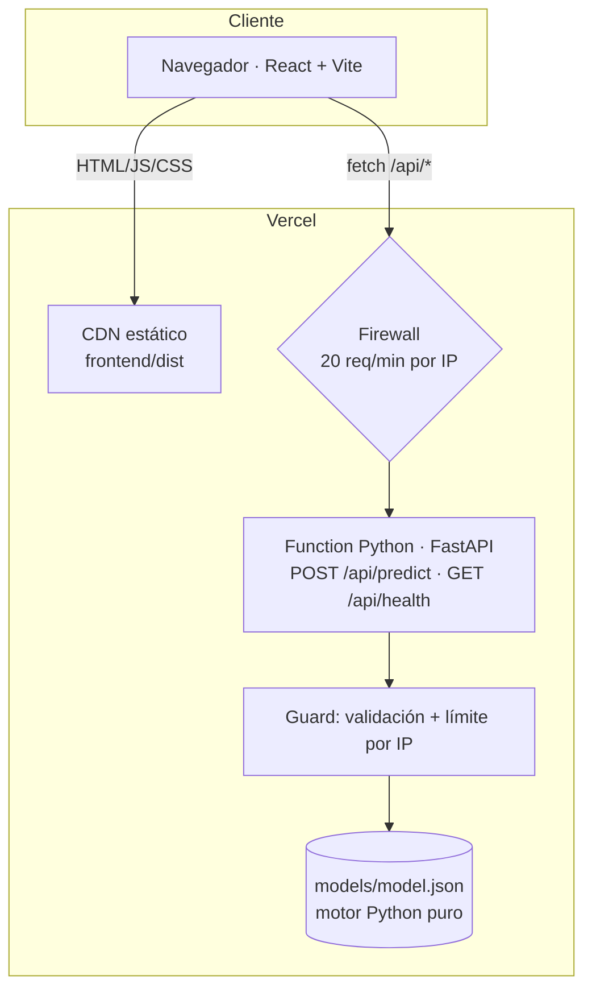

# Arquitectura y decisiones

## Visión general

Todo vive bajo un mismo dominio (`bankml.mydatavibe.com`), así que no hay CORS ni URLs de API configurables en el frontend.

## Flujo de una predicción

1. El frontend envía el formulario a `POST /api/predict`.
2. **Validación** (Pydantic): enums y rangos derivados del dataset; campos extra rechazados; máximo 4 KB.
3. **Firewall y guard:** antes de la función, Vercel frena a más de 20 pedidos/min por IP; dentro de ella, un contador en memoria limita a 6/min y 40/día por IP y responde `429` con `Retry-After`.
4. **Inferencia** (`api/_model.py`): preprocesamiento, ensamble de árboles y **TreeSHAP exacto** en Python puro (~40 ms).
5. Se calibra la probabilidad (Platt) y se asigna la prioridad (alta ≥ 30 %, media ≥ 12 %, baja).
6. Se responde y **no se guarda nada**: no hay base de datos.

## Decisiones y trade-offs

| Decisión | Motivo | Costo / alternativa |
|---|---|---|
| Serverless (Vercel Functions) | El modelo pesa 350 KB; no justifica un servidor siempre encendido. $0 fijo. | Cold start de algunos segundos tras inactividad. |
| Modelo exportado a JSON + motor en Python puro (en vez de cargar el `.joblib`) | LightGBM necesita `libgomp` (OpenMP), que el runtime de Vercel no trae: el deploy fallaba al importarlo. Al exportar el modelo desaparecen LightGBM, scikit-learn, pandas y numpy de producción: bundle y cold start menores y sin acoplamiento a versiones del pickle. | Hay que mantener el motor propio; un test de paridad (features, probabilidad y SHAP vs. LightGBM, tolerancia 1e-8) lo protege. |
| TreeSHAP propio en vez de la librería `shap` | Mismos valores exactos para árboles, sin numba/llvmlite. | Sólo válido para modelos de árboles. |
| Una invocación por consulta (predicción + explicación juntas) | La v1 hacía 2 requests; esto reduce a la mitad el consumo del free tier. | Respuesta algo más grande. |
| Límites en dos capas, sin base de datos | El firewall de Vercel corta a los bots antes de gastar una invocación; la función agrega un límite por IP en memoria. Menos piezas que proteger y mantener que con una base compartida. | Los contadores de la función son por instancia (no hay tope global exacto); el techo real del costo es el plan Hobby, que pausa en vez de cobrar. |
| Sin historial ni persistencia | Una demo no necesita guardar consultas de desconocidos; evita infraestructura y datos personales. | Sin analítica de uso. |
| Probabilidad calibrada + prioridad en vez de "sí/no" | El entrenamiento con `scale_pos_weight` infla las probabilidades; un umbral de 0,5 clasifica como "sí" al 18 % y mezcla aciertos con falsos positivos. La calibración (Brier 0,149 → 0,074) permite hablar en probabilidades reales y priorizar. | Los umbrales de prioridad son de negocio: se fijaron mirando precisión y cobertura en test y conviene revisarlos con el costo real de contacto. |
| UI que traduce al formato del dataset | Las 19 variables originales incluyen campos que el modelo ignora (`duration`, `day_of_week`) y 5 macro que son una foto del trimestre. El formulario hace 11 preguntas y mapea el resto. | El mapeo vive en el frontend (`frontend/src/lib/config.js`); la API sigue validando el contrato completo. |
| Preprocesamiento con semántica de entrenamiento | La v1 aplicaba `get_dummies(drop_first=True)` a un único registro y anulaba la variable `month` (26 % de predicciones distintas a las del lote). | El preprocesamiento vive en dos lugares (entrenamiento y API); el test de paridad los mantiene alineados. |

## v1 en AWS (histórico)

Frontend en S3 + backend Flask en EC2 (Docker). El modelo corría en un contenedor con el contrato de inferencia de SageMaker (`/ping`, `/invocations`), **pero no se usó SageMaker administrado**. Ver [`legacy/aws/README.md`](../legacy/aws/README.md).

## Qué haría para producción real

- **Serving:** endpoint de SageMaker (o batch transform) con auto-scaling, o un servicio containerizado detrás de un balanceador.
- **MLOps:** registry de modelos con versionado, pipeline de reentrenamiento y validación antes de promover.
- **Monitoreo:** drift de datos y de predicciones; las variables macroeconómicas son trimestrales y cambian el contexto.
- **Decisión de negocio:** umbral calibrado según costo de contacto vs. valor del depósito, en lugar de 0.5 fijo.
- **Seguridad:** autenticación del operador, auditoría y control de acceso a datos de clientes.
- **Calidad del modelo:** el dataset es de 2008–2010; evaluar con validación temporal y recalibrar.
